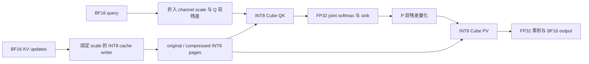

# 执行架构

## 数据流

original SWA 和 compressed keys 参加同一个 softmax；两种 KV 可以使用不同的冻结
channel scale。sink 只影响归一化。Q/P 的高低两路残差参与 INT8 matmul，KV 仅存一份
INT8 数据。RoPE 在进入此算子前完成。

## 源码分层

| 层 | 文件 | 职责 |
| --- | --- | --- |
| Python attention | `attention.py`、`c8_attention.py` | 校验、prepare、ABI、默认路由与 scratch 生命周期 |
| KV writer | `cache.py`、`csrc/kernels/cache_write.cpp` | 对同一套 scale / page 编码执行增量写入 |
| 默认设备核心 | `csrc/kernels/c8/` | C4/C128、成本调度、受限 KV 驻留、Cube/Vector 流水 |
| 兼容设备核心 | `csrc/kernels/` 其他文件 | R1、显式 draft、prefill/其他必要 ABI、variant0..11 |
| host bridge | `csrc/host/` | 调用方 stream、参数值捕获、有序 host queue |
| vLLM | `vllm_plugin.py`、`vllm_adapter.py`、`vllm_metadata.py` | opt-in、每层 runtime、metadata、DSpark writer |
| cache allocation | `cache_layout.py` | 各类 cache 的 packed page 预算及真实 stride view |

上表 Python 文件均位于 `npu_sparse_attn_sharedkv_int8/`。

## p101 核心

默认核心由 `c4.cpp`、`c4_small.cpp`、`c128.cpp` 三个编译单元组成。任务归属由
AIC / 双 AIV 共用；调度使用 metadata 和资源成本，不维护 shape 白名单。
L1 中的 KV 驻留受资源上限约束，超出时继续 INT8 分块。

设备端按活跃长度选择 tile / query group，无 CPU 长度回读；batch/query 准入不受
旧 B8/T48 上限约束。具体 shape 仍受内存、索引范围和 ABI 约束。

这次整理逐字节保留 43 份设备源码、两份 host C++ 源码和设备编译单元顺序。
重新构建的 `libsharedkv_c8.so` 与 `libsharedkv_int8.so` 均与定版 SHA-256 相同。
host bridge 重新链接为通过 `$ORIGIN` 加载设备库，避免固化原工程目录。

## 证据边界

保留 p101，不引入已撤回的 p102–p110、compact rows、16KiB alignment 或
ICachePreLoad。历史同步审计候选与配对性能记录位于 `docs/history/`。
数值通过与静态检查不能替代同步证明；本次目录整理不宣称解决该问题。
