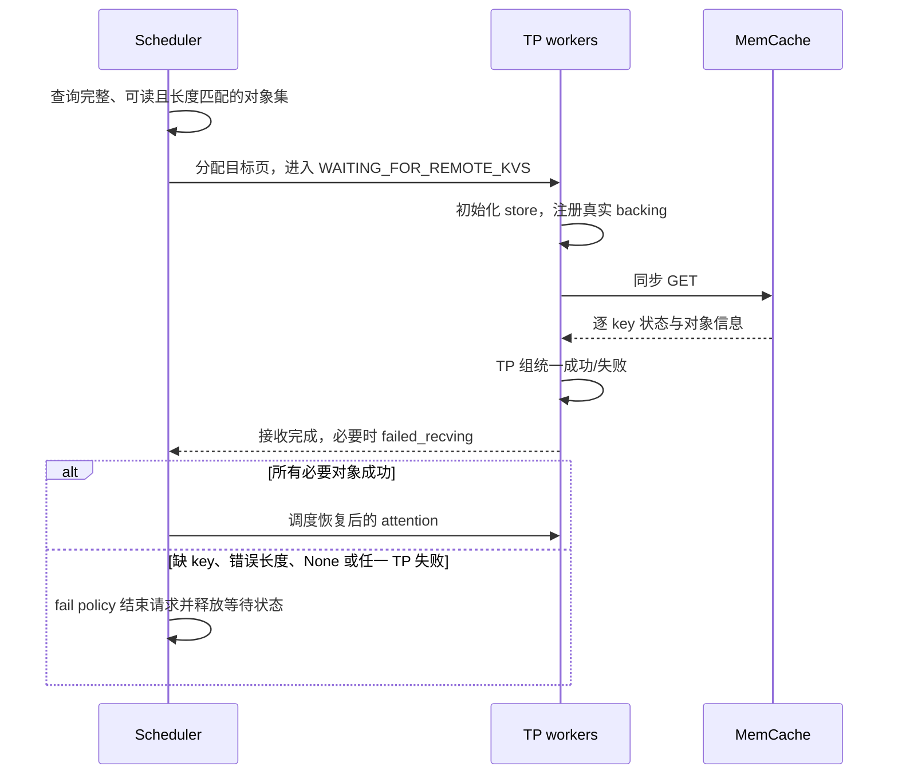

# INT8 KV / Attention 与 MemCache

此接入保留 `v65-p101-stage1` 和 `sharedkv-c8-v1` 编码。Q/P 双残差、INT8 Cube
QK/PV、FP32 softmax / 累积、冻结通道 scale 及设备源码均保持不变。需要同时安装
本插件和配套 vLLM-Ascend 补丁；只升级 wheel 不能启用 compact KV 传输。

## 支持组合

| 项目 | 本轮范围 |
| --- | --- |
| 模型 / 硬件 | DeepSeek V4 Pro w4a8，双节点 Ascend A3 |
| 并行 | DP2，每节点 DP1，TP16，EP；PP/PCP/DCP 均为 1 |
| 推理 | DSpark5、V1 runner、compact pages、host queue |
| Connector | AscendStoreConnector、kv_both、非 layerwise、同步 GET |
| 存储 | MemCache / MemFabric 1.3.0，device_sdma |
| 容量 | 每节点独立 256 GiB DRAM 池，client DRAM 0GB，高水位 70% |

PD 分离、MultiConnector、异构 TP、context parallel、后台异步加载和其他量化算法
不在首期范围。不支持的组合会在启动阶段拒绝。未配置 KV transfer 时仍支持原有
INT8 路径。

## 身份与寻址

部署前对模型配置、量化配置和权重分片计算一次内容摘要。scale 身份按层名、dtype、
shape 和规范化 FP32 数值计算；文件序列化时间或其他元数据不影响身份。部署清单再
绑定插件源码、协议补丁和 native 库，防止混装。

namespace 结合上述内容身份与实际 KV group、组件顺序、逻辑块大小和分片语义。
它不包含 DP rank、绝对路径、本地地址、物理 block 数或 stride，因此两个 DP 可以
复用同一池对象，重启后的不同物理页也可以恢复。BF16 使用原有键格式；不同权重、
scale 或不兼容布局不能误命中 C8 对象。

传输描述符取自真实 tensor view，按组件有效字节构造地址与长度。注册范围来自真实
backing allocation；共享 backing 合并注册。注册时预计算完整物理块的传输计划，
只合并字节顺序连续的组件；部分页保留原有分段路径。不会复制整个 common stride，
也不会覆盖其他 group 或 padding。

缓存内容包括 original/SWA、C4/C128、indexer KV / scale 和可恢复的 FP32 state。
冻结 scale 通过部署清单保证一致；Q/P residual 仍是计算临时量。私有状态继续按实际
分组和恢复边界保留尾部重算。

## 请求完成与失败

失败接收也必须报告完成。取消、抢占或超时不能提前复用正在传输的页。保存沿用写完成
通知和页引用保护，在 INT8 writer 完成后才 PUT。PUT 失败不影响已经完成的正常生成，
但未完成对象不能作为完整命中发布。第一次 GET 会主动初始化，无需先 PUT。

CPU metadata 转发、同步零 token 接收进度和完整块传输计划用于减少重复工作。
这些优化保留上述完成屏障和错误路径。vLLM engine loop 的优化绑定源码摘要；
上游内部接口变化时必须重新审计，不应删除校验来强行运行。

## 部署与验证

参数化步骤见 [部署说明](../examples/memcache/README.md)。框架补丁及应用前后摘要位于
`patches/vllm-ascend/`。新协议、无 MemCache 的 INT8 和 BF16 对照必须使用独立安装、
编译缓存和配置，不能覆盖活动服务使用的库。

验收依次检查 CPU 契约、真实 NPU 字节与 guard、恢复后 attention、双 DP 完整输出、
失败注入、重启首 GET、实际池占用和逐场景性能。`tests/npu/memcache/` 是显式执行的
设备测试，不属于默认 CPU CI。

性能采用相同输入、完整输出预算和调度设置，分别比较 TTFT、TPOT 与吞吐。局部 SDK
耗时、profile 中的 kernel 时间和跨场景均值均不能替代端到端非退化验收。最终结果与
未通过项见 [收尾验收](memcache-acceptance.md) 和 [压力报告](memcache-pressure-results.md)。
